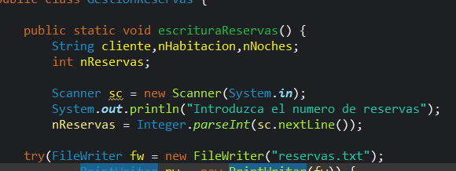

## Prueba simulacro examen
```java
Scanner sc = new Scanner(System.in);
		System.out.println("Introduzca el numero de reservas");
		nReservas = Integer.parseInt(sc.nextLine());
		
	try(FileWriter fw = new FileWriter("reservas.txt"); 
			PrintWriter pw = new PrintWriter(fw)) {
		for(int i=0; i < nReservas; i++) {
			System.out.println("Introduzca el nombre de la reserva numero " + (i+1) + ":");
			cliente = sc.nextLine();
			System.out.println("Introduzca el numero de habitacion de la reserva numero " + (i+1) + ":");
			nHabitacion = sc.nextLine();
			System.out.println("Introduzca el numero de noches de la reserva numero " + (i+1) + ":");
			nNoches  = sc.nextLine();
			
			pw.println(cliente + ";" + nHabitacion + ";" + nNoches);
		}
		}	catch(FileNotFoundException e) {
			System.out.println(e.getMessage());
```

